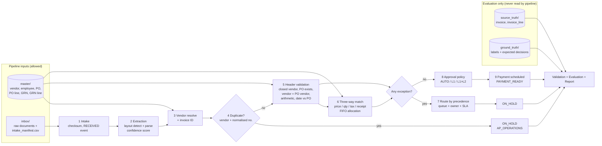

# Architecture

## Workflow

## Information barrier

| Zone | Written by | Read by pipeline? | Purpose |
|---|---|---|---|
| `master/` | generator | yes | ERP extracts: vendors, employees, POs, receipts, lifecycle history |
| `inbox/` | generator | yes | What AP actually receives: raw documents + intake manifest (channel, timestamp, sha256) |
| `source_truth/` | generator | **no** | What the vendor really billed; used to score extraction |
| `ground_truth/` | generator | **no** | Scenario labels and expected decisions; used to score decisions |
| `pipeline_output/` | pipeline | n/a | Extracted fields, decisions, exceptions, matches, approvals, payments, events |
| `exports/` | export | n/a | `seed.sql`, `ap_automation.db` (SQLite), `json/` |
| `reports/` | validate / evaluate / report | n/a | Validation summary, metrics, manifest, reproducibility, HTML report |

A validation check (`leakage`) confirms no label columns or scenario names appear in pipeline inputs.

## Code map

| Module | Responsibility |
|---|---|
| `schema.py` | Single source of truth for all 17 tables: types, keys, FKs, enums, formats, rules. Drives DDL, docs, validation. |
| `generator/core.py` | Volume planning, master data, receipts, invoice drafts, labelled anomaly injection, IDs, ground truth |
| `generator/scenarios.py` | The rule table mapping each scenario to its expected exception, match status and edge-case tag |
| `generator/documents.py` | Renders each invoice as a CLASSIC (PDF text), EMAIL or EDI document |
| `pipeline/extraction.py` | Layout detection and field parsing, confidence score |
| `pipeline/matching.py` | Duplicate detector, stateful three-way matcher with FIFO receipt allocation |
| `pipeline/workflow.py` | Orchestration, exception precedence and routing, approval policy, payment scheduling, event log |
| `validation.py` | 87 data-quality and safety checks; labelled anomalies are allowed, anything else fails |
| `evaluation.py` | Accuracy vs source/ground truth, per-exception P/R/F1, confusion matrix, KPIs, acceptance criteria |
| `export.py` | SQL seed, SQLite load + FK check, JSON, manifest with checksums, reproducibility |
| `report.py` | Self-contained HTML report |
| `docs.py` | Regenerates `docs/data_dictionary.md` from `schema.py` |

## Design choices

- **Standard library only.** Nothing to install, nothing to break on the reviewer's machine; `sqlite3` gives a real
  database for FK checks.
- **Deterministic everywhere.** One seeded RNG in the generator; the pipeline uses no randomness at all (timestamps
  are offsets from `received_at`, assignees are round-robin). Same seed gives byte-identical files.
- **Exact volumes, not approximate.** `plan_counts()` solves for how many POs are fully received, split across two
  deliveries, still open, or received-but-not-invoiced so that every target (300 / 1,500 / 2,200 / 1,800 / 2,000)
  and the issue mix land exactly. It raises `InfeasibleVolumes` rather than silently drifting.
- **Decimal money.** All amounts use `Decimal` with half-up rounding; tolerances are compared in integer/decimal
  arithmetic, so boundary cases (exactly +2.00%, exactly +5% quantity) behave as documented.
- **Batch is stateful, like a real AP ledger.** Quantity billed against each PO line is remembered across invoices,
  so a third invoice against a fully billed PO is caught even if each invoice looks fine alone.
