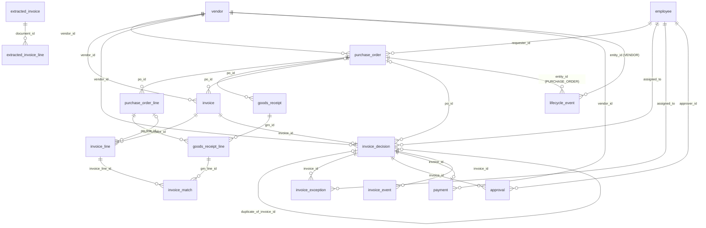

# Data dictionary

Generated from `backend/src/ap_automation/schema.py` by `python -m ap_automation docs`. Do not edit by hand.

## Entities

| Table | Zone | Primary key | Rows describe |
|---|---|---|---|
| `employee` | master | `employee_id` | Primary actors: requesters, approvers, AP analysts, process owners, system admins. |
| `vendor` | master | `vendor_id` | Supplier master. Created first; every PO and invoice references it. |
| `purchase_order` | master | `po_id` | Purchase order header. |
| `purchase_order_line` | master | `po_line_id` | PO line: what was ordered, at what price and tax code. |
| `goods_receipt` | master | `grn_id` | Goods receipt note (GRN) header: one delivery against a PO. |
| `goods_receipt_line` | master | `grn_line_id` | Quantity received per PO line in one delivery. |
| `lifecycle_event` | master | `event_id` | Append-only state history for vendors and POs (never overwritten). |
| `invoice` | source_truth | `invoice_id` | Invoice as issued by the vendor (truth). The pipeline never reads this table; it re-derives these fields from the raw document. |
| `invoice_line` | source_truth | `invoice_line_id` | Invoice line as issued by the vendor. |
| `extracted_invoice` | pipeline_output | `document_id` | Header fields extracted from the raw document. |
| `extracted_invoice_line` | pipeline_output | `extracted_line_id` | Lines extracted from the raw document. |
| `invoice_decision` | pipeline_output | `invoice_id` | One row per processed invoice: match result, exceptions, decision. |
| `invoice_match` | pipeline_output | `match_id` | Bridge (N:M) between invoice lines and goods receipt lines; quantity allocated FIFO. |
| `invoice_exception` | pipeline_output | `exception_id` | Every exception raised, routed to a queue and owner with an SLA. |
| `approval` | pipeline_output | `approval_id` | Approval records, created only for eligible (exception-free) invoices. |
| `payment` | pipeline_output | `payment_id` | Payment scheduled for approved invoices only (1:1 with invoice). |
| `invoice_event` | pipeline_output | `event_id` | Append-only invoice state history. |

## Entity-relationship diagram

## Relationships and cardinality

| Child.column | → Parent | Cardinality (child:parent) | Optional |
|---|---|---|---|
| `purchase_order.vendor_id` | `vendor.vendor_id` | N:1 | no |
| `purchase_order.requester_id` | `employee.employee_id` | N:1 | no |
| `purchase_order_line.po_id` | `purchase_order.po_id` | N:1 | no |
| `goods_receipt.po_id` | `purchase_order.po_id` | N:1 | no |
| `goods_receipt_line.grn_id` | `goods_receipt.grn_id` | N:1 | no |
| `goods_receipt_line.po_line_id` | `purchase_order_line.po_line_id` | N:1 | no |
| `invoice.vendor_id` | `vendor.vendor_id` | N:1 | no |
| `invoice.po_id` | `purchase_order.po_id` | N:0..1 | yes |
| `invoice_line.invoice_id` | `invoice.invoice_id` | N:1 | no |
| `invoice_line.po_line_id` | `purchase_order_line.po_line_id` | N:0..1 | yes |
| `extracted_invoice_line.document_id` | `extracted_invoice.document_id` | N:1 | no |
| `invoice_decision.invoice_id` | `invoice.invoice_id` | 1:1 | no |
| `invoice_decision.vendor_id` | `vendor.vendor_id` | N:1 | yes |
| `invoice_decision.po_id` | `purchase_order.po_id` | N:0..1 | yes |
| `invoice_decision.duplicate_of_invoice_id` | `invoice_decision.invoice_id` | N:0..1 | yes |
| `invoice_decision.assigned_to` | `employee.employee_id` | N:1 | yes |
| `invoice_match.invoice_line_id` | `invoice_line.invoice_line_id` | N:1 | no |
| `invoice_match.grn_line_id` | `goods_receipt_line.grn_line_id` | N:1 | no |
| `invoice_exception.invoice_id` | `invoice_decision.invoice_id` | N:1 | no |
| `invoice_exception.assigned_to` | `employee.employee_id` | N:1 | no |
| `approval.invoice_id` | `invoice_decision.invoice_id` | N:1 | no |
| `approval.approver_id` | `employee.employee_id` | N:1 | yes |
| `payment.invoice_id` | `invoice_decision.invoice_id` | 1:1 | no |
| `payment.vendor_id` | `vendor.vendor_id` | N:1 | no |
| `invoice_event.invoice_id` | `invoice_decision.invoice_id` | N:1 | no |

Many-to-many: `invoice_line` ↔ `goods_receipt_line` is N:M (one invoice line can consume several deliveries, one delivery can be billed across several invoices). It is resolved by the bridge table `invoice_match` (quantity allocated FIFO by receipt date).

## Lifecycle states (append-only history)

- **Vendor** (`lifecycle_event`): ∅ → ACTIVE, ACTIVE → CLOSED. Effective dates: `effective_from`, `effective_to`.
- **Purchase order** (`lifecycle_event`): ∅ → OPEN, OPEN → FULLY_RECEIVED, OPEN → PARTIALLY_RECEIVED, PARTIALLY_RECEIVED → FULLY_RECEIVED. Status derived from receipts.
- **Invoice** (`invoice_event`): ∅ → RECEIVED, APPROVED → PAYMENT_READY, EXTRACTED → ON_HOLD, EXTRACTED → VALIDATED, MATCHED → PENDING_APPROVAL, PENDING_APPROVAL → APPROVED, RECEIVED → EXTRACTED, VALIDATED → MATCHED, VALIDATED → ON_HOLD, VALIDATED → PENDING_APPROVAL.

Goods receipts are `POSTED`; payments are `SCHEDULED`; exceptions are `OPEN` (resolution is out of scope for a single batch run).

## `employee`

Primary actors: requesters, approvers, AP analysts, process owners, system admins.

| Field | Type | Req. | Allowed values / format | Unit | Unique | Validation rule |
|---|---|---|---|---|---|---|
| `employee_id` | str | Y | `^EMP-\d{4}$` |  | Y | Employee / actor ID |
| `full_name` | str | Y |  |  |  | Synthetic full name |
| `department` | str | Y | OPERATIONS, IT, FACILITIES, MANUFACTURING, MARKETING, FINANCE |  |  | Owning department |
| `role` | str | Y | REQUESTER, APPROVER_L1, APPROVER_L2, AP_ANALYST, PROCESS_OWNER, SYSTEM_ADMIN |  |  | Workflow role |
| `approval_limit` | money | N |  | USD |  | Max invoice value this approver may approve; set only for APPROVER_L1 / APPROVER_L2 |
| `status` | str | Y | ACTIVE |  |  | Employment status |

## `vendor`

Supplier master. Created first; every PO and invoice references it.

| Field | Type | Req. | Allowed values / format | Unit | Unique | Validation rule |
|---|---|---|---|---|---|---|
| `vendor_id` | str | Y | `^VND-\d{5}$` |  | Y | Vendor ID |
| `vendor_code` | str | Y | `^[A-Z]{4}\d{3,}$` |  | Y | Short code used inside invoice IDs |
| `vendor_name` | str | Y |  |  | Y | Legal name (synthetic) |
| `tax_id` | str | Y | `^\d{2}-\d{7}$` |  | Y | Synthetic tax registration number |
| `country` | str | Y | US, IN, GB, DE, SG |  |  | ISO country |
| `primary_category` | str | Y | IT_HARDWARE, OFFICE_SUPPLIES, MRO, PACKAGING, RAW_MATERIALS, FACILITIES_SUPPLIES |  |  | Main spend category supplied |
| `payment_terms` | str | Y | NET15, NET30, NET45, NET60 |  |  | Default payment terms |
| `payment_method` | str | Y | ACH, WIRE |  |  | Remittance method |
| `currency` | str | Y | USD |  |  | Billing currency |
| `preferred_channel` | str | Y | EMAIL, PDF_UPLOAD, EDI |  |  | Usual invoice submission channel |
| `status` | str | Y | ACTIVE, CLOSED |  |  | Lifecycle state |
| `effective_from` | date | Y |  |  |  | Onboarding date |
| `effective_to` | date | N |  |  |  | Closure date; required iff status=CLOSED; >= effective_from |

## `purchase_order`

Purchase order header.

| Field | Type | Req. | Allowed values / format | Unit | Unique | Validation rule |
|---|---|---|---|---|---|---|
| `po_id` | str | Y | `^PO-\d{4}-\d{6}$` |  | Y | PO number |
| `vendor_id` | str | Y |  |  |  | Ordering vendor; FK → `vendor.vendor_id` |
| `po_date` | date | Y |  |  |  | PO issue date; within vendor effective dates |
| `requester_id` | str | Y |  |  |  | Business requester; FK → `employee.employee_id` |
| `department` | str | Y | OPERATIONS, IT, FACILITIES, MANUFACTURING, MARKETING, FINANCE |  |  | Requesting department |
| `currency` | str | Y | USD |  |  | PO currency |
| `status` | str | Y | OPEN, PARTIALLY_RECEIVED, FULLY_RECEIVED |  |  | Derived from receipts |
| `line_count` | int | Y |  |  |  | Number of PO lines; 1..8, = count(purchase_order_line) |
| `subtotal` | money | Y |  | USD |  | Sum of line_amount |
| `tax_amount` | money | Y |  | USD |  | Sum of line tax_amount |
| `total_amount` | money | Y |  | USD |  | subtotal + tax_amount |

## `purchase_order_line`

PO line: what was ordered, at what price and tax code.

| Field | Type | Req. | Allowed values / format | Unit | Unique | Validation rule |
|---|---|---|---|---|---|---|
| `po_line_id` | str | Y | `^POL-PO-\d{4}-\d{6}-\d{2}$` |  | Y | PO line ID |
| `po_id` | str | Y |  |  |  | Parent PO; FK → `purchase_order.po_id` |
| `line_number` | int | Y |  |  |  | 1-based line number; unique within PO |
| `sku` | str | Y | `^SKU-[A-Z]{3}-\d{4}$` |  |  | Item SKU; unique within PO |
| `description` | str | Y |  |  |  | Item description |
| `uom` | str | Y | EA, BOX, ROLL, KG, L, HR, MO, PAIR, SET |  |  | Unit of measure |
| `quantity` | int | Y |  | uom |  | Ordered quantity; > 0 |
| `unit_price` | money | Y |  | USD |  | Agreed unit price; > 0, 2 decimals |
| `tax_code` | str | Y | TX00, TX05, TX12, TX18 |  |  | Tax code |
| `tax_rate` | rate | Y |  |  |  | Rate implied by tax_code; = tax_codes[tax_code] |
| `line_amount` | money | Y |  | USD |  | quantity * unit_price |
| `tax_amount` | money | Y |  | USD |  | round(line_amount * tax_rate, 2) |

## `goods_receipt`

Goods receipt note (GRN) header: one delivery against a PO.

| Field | Type | Req. | Allowed values / format | Unit | Unique | Validation rule |
|---|---|---|---|---|---|---|
| `grn_id` | str | Y | `^GRN-\d{4}-\d{6}$` |  | Y | GRN number |
| `po_id` | str | Y |  |  |  | PO received against; FK → `purchase_order.po_id` |
| `receipt_date` | date | Y |  |  |  | Date goods were received; >= po_date |
| `warehouse` | str | Y | WH-NORTH, WH-SOUTH, WH-EAST, WH-WEST |  |  | Receiving site |
| `status` | str | Y | POSTED |  |  | Posting state |

## `goods_receipt_line`

Quantity received per PO line in one delivery.

| Field | Type | Req. | Allowed values / format | Unit | Unique | Validation rule |
|---|---|---|---|---|---|---|
| `grn_line_id` | str | Y | `^GRNL-GRN-\d{4}-\d{6}-\d{2}$` |  | Y | GRN line ID |
| `grn_id` | str | Y |  |  |  | Parent GRN; FK → `goods_receipt.grn_id` |
| `po_line_id` | str | Y |  |  |  | PO line received; po_line.po_id = grn.po_id; FK → `purchase_order_line.po_line_id` |
| `line_number` | int | Y |  |  |  | 1-based line number |
| `quantity_received` | int | Y |  | uom |  | Units received; > 0 |
| `receipt_type` | str | Y | FULL, PARTIAL, OVER |  |  | Cumulative received vs ordered after this line |

## `lifecycle_event`

Append-only state history for vendors and POs (never overwritten).

| Field | Type | Req. | Allowed values / format | Unit | Unique | Validation rule |
|---|---|---|---|---|---|---|
| `event_id` | str | Y | `^LEV-\d{7}$` |  | Y | Event ID |
| `entity_type` | str | Y | VENDOR, PURCHASE_ORDER |  |  | Entity |
| `entity_id` | str | Y |  |  |  | vendor_id or po_id; polymorphic FK, validated per entity_type |
| `from_state` | str | N | ACTIVE, CLOSED, OPEN, PARTIALLY_RECEIVED, FULLY_RECEIVED |  |  | Previous state (empty on creation) |
| `to_state` | str | Y | ACTIVE, CLOSED, OPEN, PARTIALLY_RECEIVED, FULLY_RECEIVED |  |  | New state |
| `event_date` | date | Y |  |  |  | When the state changed |
| `detail` | str | N |  |  |  | Trigger, e.g. GRN ID |

## `invoice`

Invoice as issued by the vendor (truth). The pipeline never reads this table; it re-derives these fields from the raw document.

| Field | Type | Req. | Allowed values / format | Unit | Unique | Validation rule |
|---|---|---|---|---|---|---|
| `invoice_id` | str | Y | `^INV-[A-Z]{4}\d{3,}-\d{4}-\d{6}$` |  | Y | Internal invoice ID |
| `document_id` | str | Y | `^DOC-\d{4}-\d{6}$` |  | Y | Raw document in the inbox |
| `vendor_id` | str | Y |  |  |  | Issuing vendor; FK → `vendor.vendor_id` |
| `po_id` | str | N |  |  |  | Referenced PO (empty for non-PO invoices); FK → `purchase_order.po_id` |
| `vendor_invoice_number` | str | Y |  |  |  | Number printed by vendor; (vendor, normalised number) unique except labelled duplicates |
| `invoice_date` | date | Y |  |  |  | Invoice date; >= po_date unless labelled DATE_BEFORE_PO |
| `received_at` | datetime | Y |  |  |  | Intake timestamp; >= invoice_date |
| `channel` | str | Y | EMAIL, PDF_UPLOAD, EDI |  |  | Submission channel |
| `currency` | str | Y | USD |  |  | Currency |
| `payment_terms` | str | Y | NET15, NET30, NET45, NET60 |  |  | Terms on invoice |
| `due_date` | date | Y |  |  |  | invoice_date + terms days |
| `line_count` | int | Y |  |  |  | Number of invoice lines; = count(invoice_line) |
| `subtotal` | money | Y |  | USD |  | Sum of line_amount |
| `tax_amount` | money | Y |  | USD |  | Sum of line tax_amount |
| `grand_total` | money | Y |  | USD |  | subtotal + tax_amount (derived) |
| `stated_total` | money | Y |  | USD |  | Total printed on the document; = grand_total unless labelled TOTAL_MISMATCH |

## `invoice_line`

Invoice line as issued by the vendor.

| Field | Type | Req. | Allowed values / format | Unit | Unique | Validation rule |
|---|---|---|---|---|---|---|
| `invoice_line_id` | str | Y | `^INVL-INV-[A-Z]{4}\d{3,}-\d{4}-\d{6}-\d{2}$` |  | Y | Invoice line ID |
| `invoice_id` | str | Y |  |  |  | Parent invoice; FK → `invoice.invoice_id` |
| `line_number` | int | Y |  |  |  | 1-based line number |
| `po_line_id` | str | N |  |  |  | PO line billed (empty for non-PO); FK → `purchase_order_line.po_line_id` |
| `sku` | str | Y | `^SKU-[A-Z]{3}-\d{4}$` |  |  | Item SKU |
| `description` | str | Y |  |  |  | Item description |
| `uom` | str | Y | EA, BOX, ROLL, KG, L, HR, MO, PAIR, SET |  |  | Unit of measure |
| `quantity` | int | Y |  |  |  | Billed quantity; > 0 |
| `unit_price` | money | Y |  | USD |  | Billed unit price; > 0, 2 decimals |
| `tax_code` | str | Y | TX00, TX05, TX12, TX18 |  |  | Billed tax code |
| `tax_rate` | rate | Y |  |  |  | Rate implied by tax_code |
| `line_amount` | money | Y |  | USD |  | quantity * unit_price |
| `tax_amount` | money | Y |  | USD |  | round(line_amount * tax_rate, 2) |

## `extracted_invoice`

Header fields extracted from the raw document.

| Field | Type | Req. | Allowed values / format | Unit | Unique | Validation rule |
|---|---|---|---|---|---|---|
| `document_id` | str | Y | `^DOC-\d{4}-\d{6}$` |  | Y | Source document |
| `layout` | str | Y | CLASSIC, EMAIL, EDI, LLM |  |  | Detected layout; LLM = extracted by Claude fallback |
| `vendor_name` | str | N |  |  |  | Extracted vendor name |
| `vendor_tax_id` | str | N |  |  |  | Extracted vendor tax ID |
| `vendor_invoice_number` | str | N |  |  |  | Extracted invoice number |
| `invoice_date` | date | N |  |  |  | Extracted invoice date |
| `po_number` | str | N |  |  |  | Extracted PO reference |
| `currency` | str | N |  |  |  | Extracted currency |
| `payment_terms` | str | N |  |  |  | Extracted terms |
| `subtotal` | money | N |  |  |  | Extracted subtotal |
| `tax_amount` | money | N |  |  |  | Extracted tax |
| `stated_total` | money | N |  |  |  | Extracted total |
| `line_count` | int | Y |  |  |  | Lines extracted |
| `confidence` | rate | Y |  |  |  | Share of required fields found (0..1) |

## `extracted_invoice_line`

Lines extracted from the raw document.

| Field | Type | Req. | Allowed values / format | Unit | Unique | Validation rule |
|---|---|---|---|---|---|---|
| `extracted_line_id` | str | Y |  |  | Y | <document_id>-<nn> |
| `document_id` | str | Y |  |  |  | Source document; FK → `extracted_invoice.document_id` |
| `line_number` | int | Y |  |  |  | Line number |
| `sku` | str | Y |  |  |  | SKU |
| `description` | str | Y |  |  |  | Description |
| `quantity` | int | Y |  |  |  | Quantity |
| `unit_price` | money | Y |  |  |  | Unit price |
| `tax_code` | str | Y |  |  |  | Tax code |
| `line_amount` | money | Y |  |  |  | Line amount |

## `invoice_decision`

One row per processed invoice: match result, exceptions, decision.

| Field | Type | Req. | Allowed values / format | Unit | Unique | Validation rule |
|---|---|---|---|---|---|---|
| `invoice_id` | str | Y | `^INV-[A-Z]{4}\d{3,}-\d{4}-\d{6}$` |  | Y | Assigned invoice ID; FK → `invoice.invoice_id` |
| `document_id` | str | Y | `^DOC-\d{4}-\d{6}$` |  | Y | Source document |
| `vendor_id` | str | N |  |  |  | Resolved vendor; FK → `vendor.vendor_id` |
| `po_id` | str | N |  |  |  | Resolved PO; FK → `purchase_order.po_id` |
| `vendor_invoice_number` | str | N |  |  |  | Extracted invoice number |
| `invoice_date` | date | N |  |  |  | Extracted invoice date |
| `computed_total` | money | Y |  | USD |  | Total recomputed from extracted lines |
| `match_status` | str | Y | MATCHED, MATCHED_WITHIN_TOLERANCE, NON_PO, PRICE_VARIANCE, QTY_VARIANCE, TAX_VARIANCE, NO_RECEIPT, NOT_EVALUATED |  |  | Three-way match result |
| `primary_exception` | str | N | EXTRACTION_INCOMPLETE, VENDOR_UNKNOWN, DUPLICATE_INVOICE, VENDOR_CLOSED, VENDOR_MISMATCH, PO_NOT_FOUND, TOTAL_MISMATCH, DATE_BEFORE_PO, MISSING_RECEIPT, TAX_MISMATCH, QTY_EXCEEDS_PO, QTY_EXCEEDS_RECEIPT, PRICE_VARIANCE |  |  | Highest-precedence exception |
| `exception_codes` | str | N |  |  |  | All exception codes, ';'-separated |
| `exception_count` | int | Y |  |  |  | Number of exceptions raised |
| `final_status` | str | Y | PAYMENT_READY, ON_HOLD |  |  | Decision |
| `payment_ready` | bool | Y |  |  |  | True only when no blocking exception and fully approved |
| `approval_path` | str | N | AUTO, L1, L1>L2 |  |  | Approval levels applied |
| `duplicate_of_invoice_id` | str | N |  |  |  | Earlier invoice this duplicates; FK → `invoice_decision.invoice_id` |
| `route_queue` | str | N | AP_OPERATIONS, VENDOR_MASTER, RECEIVING_CONFIRMATION, TAX_REVIEW, PROCUREMENT_REVIEW |  |  | Queue of primary exception |
| `assigned_to` | str | N |  |  |  | Owner of primary exception; FK → `employee.employee_id` |
| `extraction_confidence` | rate | Y |  |  |  | From extraction |
| `processed_at` | datetime | Y |  |  |  | Decision timestamp |

## `invoice_match`

Bridge (N:M) between invoice lines and goods receipt lines; quantity allocated FIFO.

| Field | Type | Req. | Allowed values / format | Unit | Unique | Validation rule |
|---|---|---|---|---|---|---|
| `match_id` | str | Y | `^MAT-\d{4}-\d{6}$` |  | Y | Match ID |
| `invoice_line_id` | str | Y |  |  |  | Invoice line; FK → `invoice_line.invoice_line_id` |
| `grn_line_id` | str | Y |  |  |  | Receipt line; FK → `goods_receipt_line.grn_line_id` |
| `matched_qty` | int | Y |  |  |  | Quantity allocated; > 0; sum per grn_line <= quantity_received |

## `invoice_exception`

Every exception raised, routed to a queue and owner with an SLA.

| Field | Type | Req. | Allowed values / format | Unit | Unique | Validation rule |
|---|---|---|---|---|---|---|
| `exception_id` | str | Y | `^EXC-\d{4}-\d{6}$` |  | Y | Exception ID |
| `invoice_id` | str | Y |  |  |  | Invoice; FK → `invoice_decision.invoice_id` |
| `invoice_line_id` | str | N |  |  |  | Line, when line-level |
| `exception_code` | str | Y | EXTRACTION_INCOMPLETE, VENDOR_UNKNOWN, DUPLICATE_INVOICE, VENDOR_CLOSED, VENDOR_MISMATCH, PO_NOT_FOUND, TOTAL_MISMATCH, DATE_BEFORE_PO, MISSING_RECEIPT, TAX_MISMATCH, QTY_EXCEEDS_PO, QTY_EXCEEDS_RECEIPT, PRICE_VARIANCE |  |  | Exception type |
| `severity` | str | Y | HIGH, MEDIUM |  |  | Severity |
| `is_primary` | bool | Y |  |  |  | Highest precedence for this invoice |
| `queue` | str | Y | AP_OPERATIONS, VENDOR_MASTER, RECEIVING_CONFIRMATION, TAX_REVIEW, PROCUREMENT_REVIEW |  |  | Work queue |
| `assigned_to` | str | Y |  |  |  | Owner; FK → `employee.employee_id` |
| `detail` | str | Y |  |  |  | Human-readable explanation |
| `expected_value` | str | N |  |  |  | Policy / PO value |
| `actual_value` | str | N |  |  |  | Invoice value |
| `status` | str | Y | OPEN |  |  | Exception state |
| `created_at` | datetime | Y |  |  |  | Raised at |
| `sla_due_at` | datetime | Y |  |  |  | created_at + queue SLA |

## `approval`

Approval records, created only for eligible (exception-free) invoices.

| Field | Type | Req. | Allowed values / format | Unit | Unique | Validation rule |
|---|---|---|---|---|---|---|
| `approval_id` | str | Y | `^APR-\d{4}-\d{6}$` |  | Y | Approval ID |
| `invoice_id` | str | Y |  |  |  | Invoice; FK → `invoice_decision.invoice_id` |
| `level` | int | Y |  |  |  | 0 = auto, 1 = manager, 2 = finance director |
| `approver_type` | str | Y | SYSTEM, HUMAN |  |  | Who approved |
| `approver_id` | str | N |  |  |  | Approver (empty for SYSTEM); FK → `employee.employee_id` |
| `decision` | str | Y | APPROVED |  |  | Outcome |
| `policy_rule` | str | Y |  |  |  | Rule that required this approval |
| `decided_at` | datetime | Y |  |  |  | Decision timestamp |

## `payment`

Payment scheduled for approved invoices only (1:1 with invoice).

| Field | Type | Req. | Allowed values / format | Unit | Unique | Validation rule |
|---|---|---|---|---|---|---|
| `payment_id` | str | Y | `^PAY-\d{4}-\d{6}$` |  | Y | Payment ID |
| `invoice_id` | str | Y |  |  | Y | Invoice paid; FK → `invoice_decision.invoice_id` |
| `vendor_id` | str | Y |  |  |  | Payee; FK → `vendor.vendor_id` |
| `amount` | money | Y |  | USD |  | = invoice computed_total |
| `currency` | str | Y | USD |  |  | Currency |
| `method` | str | Y | ACH, WIRE |  |  | Remittance method |
| `scheduled_date` | date | Y |  |  |  | max(due_date, approval date + 1) |
| `status` | str | Y | SCHEDULED |  |  | Payment state |
| `created_at` | datetime | Y |  |  |  | When scheduled |

## `invoice_event`

Append-only invoice state history.

| Field | Type | Req. | Allowed values / format | Unit | Unique | Validation rule |
|---|---|---|---|---|---|---|
| `event_id` | str | Y | `^IEV-\d{7}$` |  | Y | Event ID |
| `invoice_id` | str | Y |  |  |  | Invoice; FK → `invoice_decision.invoice_id` |
| `seq` | int | Y |  |  |  | Order within invoice |
| `from_state` | str | N | RECEIVED, EXTRACTED, VALIDATED, MATCHED, PENDING_APPROVAL, APPROVED, PAYMENT_READY, ON_HOLD |  |  | Previous state |
| `to_state` | str | Y | RECEIVED, EXTRACTED, VALIDATED, MATCHED, PENDING_APPROVAL, APPROVED, PAYMENT_READY, ON_HOLD |  |  | New state |
| `event_ts` | datetime | Y |  |  |  | Timestamp |
| `actor` | str | Y |  |  |  | SYSTEM or employee_id |
| `detail` | str | N |  |  |  | Reason |

## Type conventions

- `money`: decimal, exactly 2 places, USD, rounded half-up. `rate`: decimal fraction (0.18 = 18%).
- `date`: ISO `YYYY-MM-DD`. `datetime`: ISO `YYYY-MM-DDTHH:MM:SS` (local, no TZ).
- `bool`: `true` / `false`. Empty cell = NULL.
